<div align="center">
  
  <h1>SoundSpectra · 声谱</h1>
  <p>让音乐成为桌面的一部分。</p>
  <p>音乐灯效 · 演出编排 · 动态歌词 · 音乐卡片 · 拾光绳 · 壁纸氛围</p>
  <p><strong>1.0.10</strong> · Windows x64 / macOS Universal · React / Three.js / Tauri / Rust</p>
  <p><a href="https://github.com/SexyAhri/SoundSpectra/releases">下载安装包</a> · <a href="#项目展示">项目展示</a> · <a href="#开发运行">开发运行</a> · <a href="https://github.com/SexyAhri/SoundSpectra/issues">反馈问题</a></p>
</div>

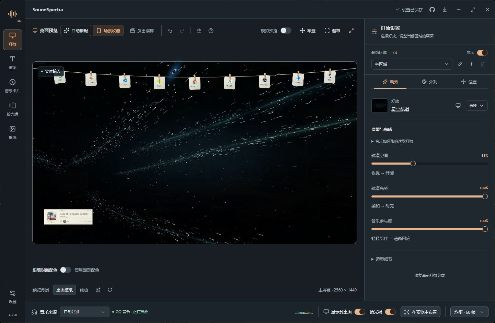

SoundSpectra 是一款桌面音乐可视化工具。它捕获所选播放器的音频，让三维灯效、动态歌词和音乐信息融入桌面；日常使用时保持鼠标穿透。Windows 使用进程音频环回与桌面宿主，macOS 使用 ScreenCaptureKit 与 AppKit 桌面层。

## 项目展示

### 桌面实机效果

星尘航道与极光流域融入桌面，拾光绳悬挂常用软件，动态歌词随播放器同步。工作台预览与桌面输出使用同一套场景设置。

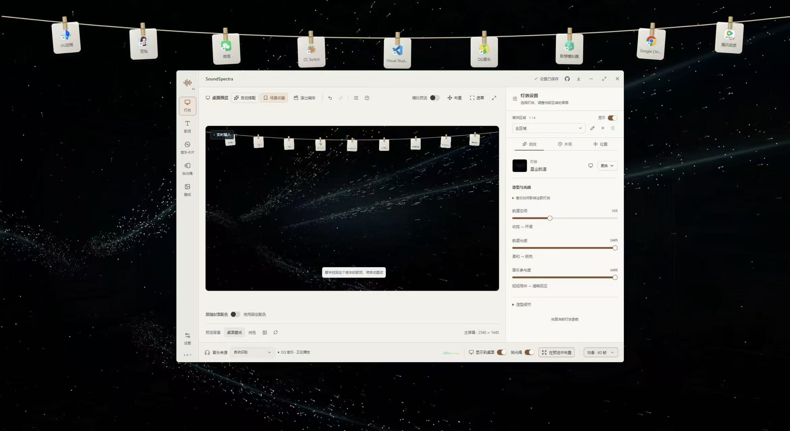

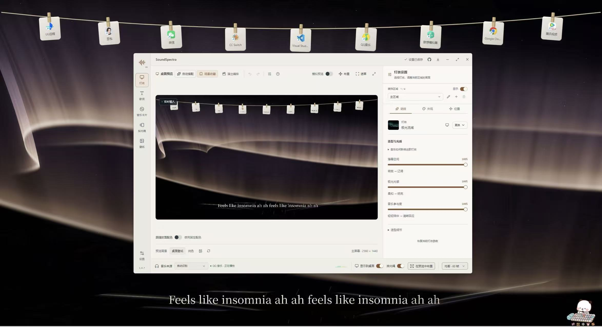

### 音乐有形，桌面有光

18 种可选灯效，包括浮光水母、银河、晴空浮游、雪花飘舞、极光流域，以及潮汐之结、层海、回声廊道、风栖蝶群、水光焦散、秋光银杏和星脉旷野。最多四个独立区域，可以分别调整位置、大小、视角和外观，再用最多八个柔边遮罩融入桌面。

灯效选择支持分类与搜索，每个区域分别记住各灯效的音乐参数和配色。画面随真实音频的频段、持续能量和起音变化；静音后停止持续运动，保留的画面仍可通过参数编辑与交互更新。

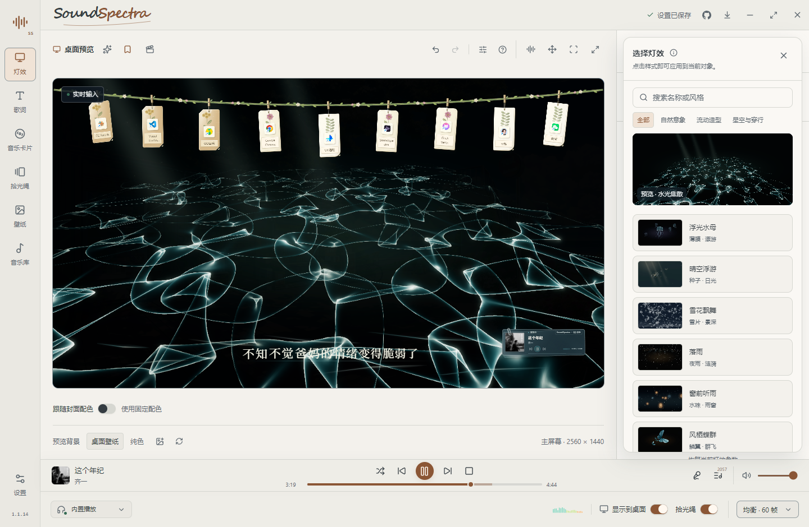

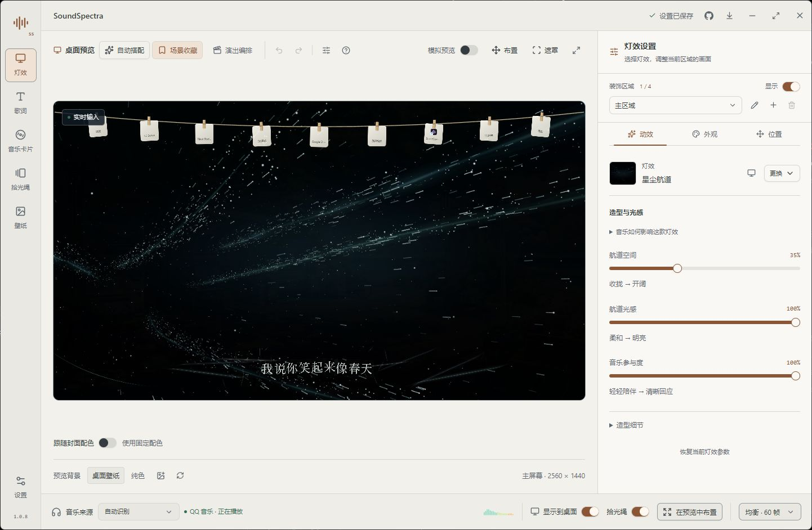

### 为一首歌编排整段画面

在预览顶部打开「演出编排」，用时间标记安排指定区域的灯效快照、配色与运镜。绑定当前曲目后开启演出，画面跟随播放器进度：暂停保持、前后跳转直接重建，切到其他歌曲时关闭演出。关闭演出会恢复基础外观，开启状态不随应用重启保留。

可以先体验 36 秒原创编排「回声航线」，也可以新建演出、编辑标记并导入导出。独立预演提供播放头和同输入映射对照，不操作音乐播放器。

转场支持柔和交叠，兼容场景还可使用粒子散聚或镜头穿越。潮汐之结、层海、回声廊道可进一步设置音乐映射，用频段能量或起音驱动路径弯曲、局部展开。操作步骤与兼容范围见 [演出编排说明](docs/PERFORMANCE.md)。

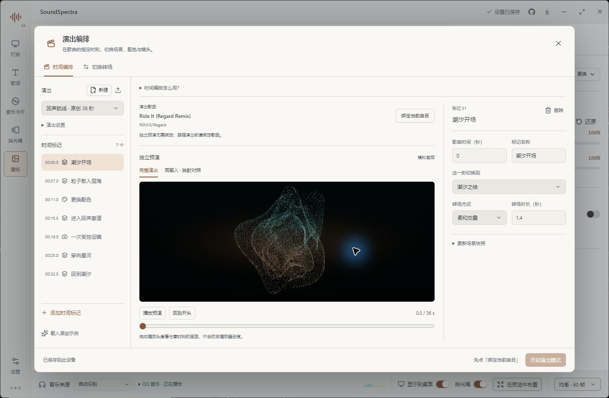

### 歌词也能成为构图

四种动态文字编排，支持逐字高亮、位置拖放、缩放、背景透明度和同步微调。时间由播放器驱动，暂停、拖动进度和切歌都会重新同步。

支持文字漫游、错落排版、弧形流转和折幕，可搭配灯效与拾光绳一起展示。

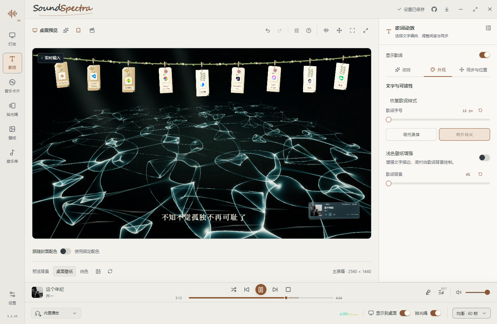

### 一处预览，分别编辑

灯效、歌词、音乐卡片、拾光绳和壁纸各有独立编辑入口，共用样式选择和参数控件。灯效按「动效 / 外观 / 位置」分开调整，切换设置页保留正在编辑的区域；预览始终可见，底部集中放置音源、桌面输出和性能控制。

「布置」模式提供对象与图层列表，可选择隐藏或重叠的对象、拖动和缩放、调整可见性与音乐视觉图层。拖动时显示对齐参考线，按住 Alt 可暂时关闭吸附。支持最多 50 步撤销重做，以及场景收藏、搜索、导入导出和快捷切换；也可根据壁纸尝试自动搭配配色与布局。

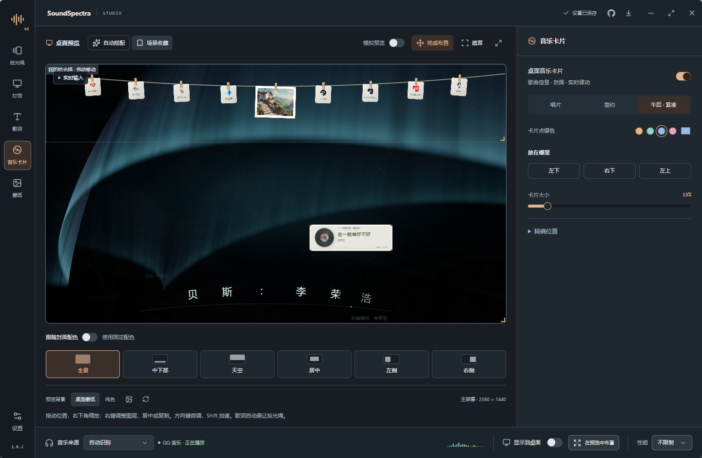

### 把正在播放的歌留在桌面

音乐卡片提供唱片、简约、「午后 · 藏书票」和「浮签」四种样式，可继承场景或封面配色，也可单独指定点缀色。歌曲信息、进度与播放控制跟随选定的播放器会话，暂停与跳转同步更新。详见 [音乐卡片说明](docs/DESKTOP.md#音乐卡片)。

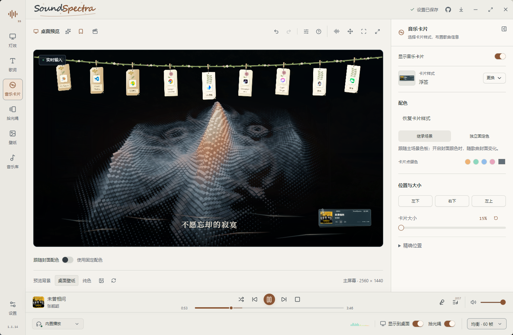

### 保留壁纸，也能回应音乐

支持跟随系统壁纸或导入自选图片，调整填满屏幕、完整显示、构图位置、亮度与饱和度。局部音乐微光可放在桌面留白处，通过拖放、缩放和遮罩控制范围，随音量舒展，静音后消退。

自选图片还可开启轻微空间视差，并根据构图选择景深模板。壁纸、微光和视差分别设置，关闭视差仍可保留静态壁纸。详见 [壁纸与氛围说明](docs/DESKTOP.md#壁纸与氛围)。

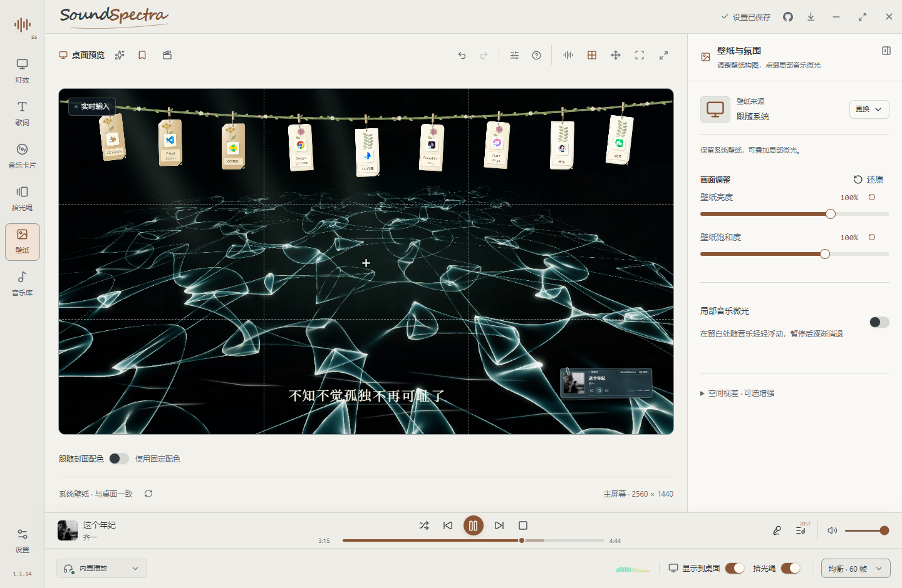

### 把日常挂在拾光绳上

将软件、文件、文件夹、图片和便签挂在桌面上，支持拖拽排序、跨组移动与最多四组独立布局。绳子沿浅弧展开，挂件带有轻柔的风吹摆动；鼠标靠近时暂停，便于操作，也遵循系统的减少动态效果设置。

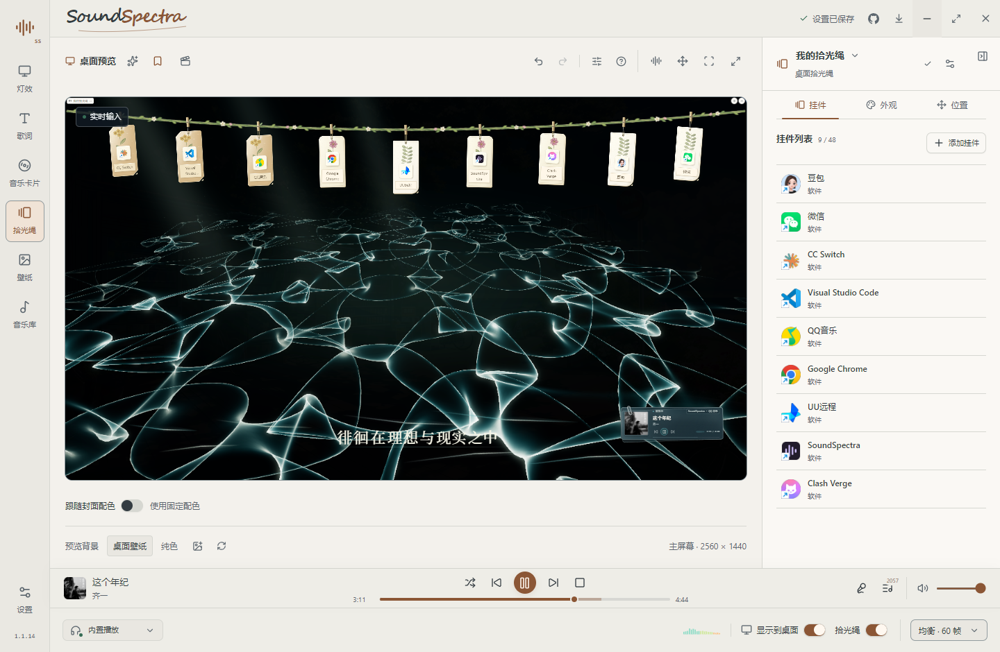

- 单击挂件打开目标；右键选中并自动居中，点击挂件下方的三个点打开操作面板。
- 滚轮或方向键切换居中挂件；单击绳子添加，双击绳子浏览和搜索全部挂件。
- Windows 桌面客户端支持从桌面添加、拖出本地项目和就地展开文件夹。浏览器中的文件路径仅用于布局示例。

展示图于 2026 年 11 月 8 日更新：星尘航道与极光流域的两张桌面全景由项目作者提供，其余为本次在 Windows 桌面客户端重新拍摄的工作台截图，展示浅色与深色主题、QQ 音乐实时输入及各模块设置。截图中的软件图标、图片、歌曲和歌词仅用于展示，相关权利归各自权利人所有。

## 使用

1. 从 [Releases](https://github.com/SexyAhri/SoundSpectra/releases) 下载 Windows x64 的 `setup.exe`，或 Mac Universal 的 `.dmg`。Mac 请将应用拖入 Applications 后运行。
2. 打开音乐播放器播放歌曲，在底部选择「自动识别」或指定音源。
3. 选好灯效，在预览中调整，再开启「显示到桌面」。歌词和音乐卡片可分别启用。
4. 需要整理桌面时，进入「拾光绳」添加挂件或便签，并单独开启桌面显示。
5. 想让场景随歌曲段落切换时，打开预览顶部「演出编排」，先独立预演，再绑定当前曲目并开启演出模式。实际跟随需要播放器提供可靠的歌曲身份与进度。

音源菜单支持 **QQ 音乐、网易云音乐、酷狗音乐、汽水音乐**。每家播放器独立读取自身的本地资料与歌词缓存，无需安装其他音乐客户端作为备用。歌词同时查找当前播放器的本地缓存与 AMLL；网易云还可根据本地资料库中的歌曲 ID 补取歌词，QQ、汽水可从各自公开接口补取歌词，无需登录。先找到有效结果就使用，成功取得的在线歌词会缓存，重启后可复用。首次发现的播放器缓存目录也会保存。详见 [歌词说明](docs/LYRICS.md)。

支持托盘、开机启动、浅色 / 深色 / 跟随系统主题，以及省电 30 帧、均衡 60 帧、流畅 120 帧和不限帧四档性能设置。预览工具栏提供快捷控制与使用指南；Ctrl / ⌘ Z 撤销，Ctrl / ⌘ Shift Z 重做，Ctrl / ⌘ K 打开快捷控制，`?` 打开指南。输入框保留自身的文字编辑快捷键。

### 酷狗自动增强同步（Windows）

自动识别实际选中酷狗，或手动选择「酷狗音乐」音源时，SoundSpectra 会自动检查并启用增强同步。普通启动的酷狗会正常退出，再带临时同步参数重新打开；已启用接口的实例直接复用。连接成功后，底部音源栏显示「酷狗音乐 · 增强同步」，音乐卡片与歌词共用实时播放进度，切歌无需等待约 30 秒的本地进度写入。

重启会短暂中断播放；原本正在播放且酷狗恢复了同一首歌时，会尝试继续播放，恢复位置由酷狗自身保存。参数仅对本次酷狗进程生效，不修改快捷方式或播放器配置。彻底关闭酷狗后，SoundSpectra 不会立即重新拉起它；再次打开并选为当前音源后，会重新检查并按需带参数重启。SoundSpectra 未运行时，从原快捷方式打开酷狗仍是普通启动。

当前已在酷狗 20.1.61.28014 验证。部分客户端需打开一次「推荐」页以加载同步接口，之后可以切换页面或最小化。无法正常重启、接口不可用或同步端口被占用时，会保留兼容同步；兼容进度首次启用、切歌或播放状态变化后可能需要等待约 30 秒。具体状态可悬停音源栏查看，重新选择音源可重试。

这套自动重启与增强同步目前仅在 Windows 实现，macOS 尚未接入。Mac 端现有歌曲与进度读取依赖播放器的公开脚本接口，四家客户端的兼容性尚未完成逐款实机验证。

### 运行条件

- Windows x64 与 WebView2 Runtime，或 macOS 13+；Mac 首次捕获需允许屏幕与系统音频录制权限。
- 歌曲与歌词同步依赖播放器提供的信息：Windows 优先使用系统媒体会话，并为网易云、酷狗和汽水补充本地播放事件、增强接口或界面进度；Mac 使用播放器的公开自动化接口，兼容性仍需逐款实测。只有取得可靠的播放进度后才能同步歌词，找到歌词正文不代表已取得同步时钟。Windows 各入口的验证范围与兼容边界见 [歌词说明](docs/LYRICS.md)。
- 浏览器模式只提供模拟预览。壁纸立体效果采用视差近似，不进行 AI 分割或三维重建。
- 正式版从 GitHub 获取签名更新并自动安装，可在应用设置中关闭；开发版不自动更新。早期 0.1.0 需手动安装新版一次。发布前需配置仓库的更新签名 Secrets。

## 开发运行

需要 Node.js 24 与 Rust stable。Windows 另需 MSVC C++ 工具、Windows SDK 和 WebView2；macOS 需 Xcode command-line tools。

```powershell
npm ci
npm run desktop
```

```powershell
npm run dev             # 浏览器模拟预览
npm run build           # 类型检查与前端构建
npm run version:check   # 检查前后端和锁文件版本
npm run test:smoke      # 手动运行应用、工作区和歌词浏览器回归
npm run test:ui         # 冻结构建的工作台检查与渲染夹具回归
npm run check:full      # 本机全量检查：前端、浏览器、Rust 测试与原生构建
npm run desktop:build   # 当前平台安装包
```

Windows 包输出到 `src-tauri/target/release/bundle/nsis/`，Mac 包位于 `bundle/dmg/`。推送 main 后由 GitHub Actions 校验版本与签名配置，同时构建两端安装包，校验产物后发布新版本。自动发布不运行格式检查和测试，完整 Checks 仅手动触发。构建与测试见 [开发说明](docs/DEVELOPMENT.md)，签名配置和自动更新见 [发布指南](docs/RELEASING.md)。

## 仓库导航

| 路径 | 内容 |
| --- | --- |
| `src/features/` | 工作台、预览、演出编排、灯效、歌词、音乐卡片、拾光绳与壁纸 |
| `src-tauri/src/` | 音频捕获、媒体会话、歌词服务、桌面集成与持久化 |
| `src/assets/`、`assets/` | 场景封面与应用图标 |
| `tests/`、`scripts/` | 回归测试、原生验收、展示捕获与构建发布工具 |
| `docs/` | 开发、各功能模块、发布说明及精选展示素材 |

[更新日志](CHANGELOG.md) · [开发约定](CONTRIBUTING.md) · [第三方声明](THIRD_PARTY_NOTICES.md)

## 版权与许可

**Copyright (C) 2026 SexyAhri.** SoundSpectra 使用 **GPL-3.0-only** 许可证，完整条款见 [LICENSE](LICENSE)，项目版权说明见 [COPYRIGHT](COPYRIGHT)。第三方组件保留各自的版权与许可证，详见 [THIRD_PARTY_NOTICES.md](THIRD_PARTY_NOTICES.md)。音乐、歌词、专辑封面及用户壁纸的权利归各自权利人所有。
