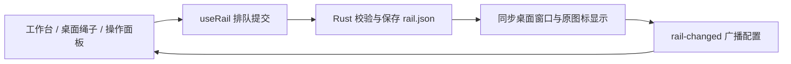

# 桌面功能与工作台

工作台编辑、音乐卡片、壁纸和拾光绳共用这一份说明。歌词获取与同步见 [歌词说明](LYRICS.md)，灯效渲染见 [视觉与音乐分析](VISUALS.md)。

- [工作台与界面](#工作台与界面)
- [音乐卡片](#音乐卡片)
- [壁纸与氛围](#壁纸与氛围)
- [拾光绳](#拾光绳)

## 工作台与界面

### 共享层

`src/components/ui` 只负责通用展示与交互，不导入功能状态或 Tauri API。

| 组件 | 使用位置与约定 |
| --- | --- |
| Button / IconButton | 普通动作 / 仅图标动作；IconButton 必须提供可访问名称，保留调用方的 ref 和事件 |
| Slider / Parameter | Slider 提供底层滑动交互；Parameter 统一标签、数值、单位、精度。`onChange` 更新草稿，`onCommit` 可用于松手保存 |
| Switch / SettingToggle | Switch 用于紧凑布局；SettingToggle 统一标题、说明与开关，说明关联到控件 |
| Tabs / ChoiceSelect / Tooltip | 统一选择、导航、浮层及焦点行为，Portal 继承根元素主题 |
| ModalContent | 共享 Radix Portal、遮罩与 Content；关闭、保存锁、Escape 和焦点恢复由功能组件负责 |
| ContextMenu | 共享右键菜单，支持键盘、边缘避让、禁用动作及焦点恢复；动作由业务层提供 |
| StylePicker | 共享样式缩略图、名称、分组与筛选交互；选项和预览由调用方提供 |

歌词、音乐卡片、拾光绳、区域布局、音乐参数、三维视角共用 Parameter。遮罩柔边等横向紧凑布局继续组合 Slider，避免给通用参数组件添加互不相关的布局开关。

### 主题

- `src/styles/themes.css` 定义两套语义颜色：背景、卡片、浮层、正文、辅助文字、强调、边框、成功、错误与阴影。
- 浅色使用暖灰白和杏棕色；深色使用蓝灰底和柔和杏色。主要文字组合在 `tests/theme.spec.ts` 检查至少 4.5:1 对比度。
- `src/index.css` 将语义颜色映射到 Tailwind；通用控件样式归 `src/components/ui/primitives.css`。
- `src/features/theme/theme.ts` 在 React 首次渲染前应用主题。`soundspectra.theme` 独立保存 `light` / `dark` / `system`，默认深色；系统模式监听系统外观变化，其他窗口通过 storage 事件同步。
- 主题切换不修改场景、歌词、拾光绳引用或应用更新偏好。桌面窗口仍保持透明背景。
- 设置入口：应用设置与更新 → 常规 → 界面主题。

### 颜色边界

灯效内容配色统一由 `effect-palette.ts` 解析暗部、主体、点缀与高光；各效果保留独立色板，旧的 iris/ember/lake 标识继续兼容。`color` 和封面取色进入所有渲染器，自然类限制着色强度。旧默认主色作为中性色板输入，进出封面跟色时连续过渡。通用 ChoiceSelect 的可选色块来自调用方，不依赖灯效模块。

灯效按自然意象、流动造型、星空与穿行分组，清单与推荐强度由 `effect-presets.ts` 维护；切换效果记住当前区域的音乐参数与配色，不修改区域位置。可选切换历史保存在本地，选中的实际参数仍走设置持久化；收藏保存完整当前外观。缩略图由 `scripts/render-effect-catalog.mjs` 调用真实渲染器生成。

功能样式使用语义变量，禁止为每个页面再写一套浅色覆盖。壁纸、频谱、场景缩略图、唱片材质、拾光绳木夹和纸张属于内容，保留自身配色。场景缩略图与画面上方提示使用固定的 artwork 色板，以免浅色主题破坏图像可读性。拾光绳菜单、输入框和便签编辑器使用界面主题，挂好的纸质便签保留纸张颜色。

### 布局与清理

- 工作区布局及断点归 `workspace-layout.css`；检查器归 `inspector.css`，工作室细节归 `studio.css`，各功能保留自身样式。
- 弹窗及图标按钮不再依赖应用设置页提供通用样式；拾光绳编辑器与桌面弹出菜单共用颜色定义。

### 桌面布置与歌词避让

桌面预览的「布置」统一支持灯效、歌词、音乐卡片及拾光绳的选择与移动。右键菜单按对象提供居中、层级、隐藏、复制或收起；拾光绳支持整体拖动和右下角调整宽度，布置时不触发挂件打开或排序。灯效、歌词、音乐卡片共用持久图层顺序，选择不再改变遮挡关系。拾光绳仍由独立桌面窗口承载，不提供无法兑现的跨窗口层级按钮。

歌词依据拾光绳的逻辑尺寸自动避让，优先保持大小平移，必要时缩小区域；不覆盖用户保存的位置。收起、移动、关闭拾光绳后重新计算；完全没有可读空间时预览提示腾出空间，桌面暂不显示被遮挡的歌词。歌词开启时原生透明承载窗口使用全屏范围，避免避让后的内容被旧窗口边界裁切。预览的拾光绳按桌面比例缩放。

主题测试覆盖保存与重载、键盘选择、跟随系统、窗口同步、透明桌面窗口、正文对比度、菜单与弹窗、各设置页和窄屏布局。现有设置、拾光绳输入、场景收藏和预览测试继续验证保存与焦点约定。测试运行在独立浏览器中，不操作正在运行的桌面客户端。

### 工作台编辑

- 底栏固定保留音乐视觉输出和拾光绳输出，不随当前编辑器切换控制范围。
- 预览工具栏支持撤销、重做、快捷控制和使用指南。首次使用的指南入口带提示点。
- 撤销最多保留 50 步，相同参数的连续调整在 450ms 内合并。输出状态、性能、个人歌词目录不随展示历史回退；替换壁纸图片时清空历史，避免引用已被替换的图片。
- 普通和放大预览的布置模式均提供对象与图层列表，可选择隐藏或重叠对象、切换可见性并调整音乐视觉图层。拾光绳仍由独立模块管理。
- 灯效区域支持与画布和其他展示对象对齐；卡片和歌词支持与画布对齐。参考线随拖动显示，Alt 可暂时关闭吸附；键盘微调不吸附。
- 卡片可在预览中拖动和通过右下角缩放；歌词提供提前/延后 0.1 秒和同步归零。
- 场景库增加构图缩略图、名称搜索、收藏排序和当前搭配对比。搜索后清除旧选择，避免应用已被过滤的场景。缩略图为布局示意，实际效果以大预览为准。
- 快捷控制可切换最近收藏或精选搭配，并管理输出与性能。托盘新增同一快捷控制入口。
- 使用指南解释音源连接、场景选择、桌面输出和无歌词状态，浏览器明确说明模拟预览范围。
- 全局隐藏滚动条，属性面板、弹窗及菜单仍保留正常滚动，不预留滚动条空槽。

快捷键：Ctrl / ⌘ Z 撤销；Ctrl / ⌘ Shift Z 或 Ctrl Y 重做；Ctrl / ⌘ K 打开快捷控制；? 打开指南。输入框保留自身的文字撤销行为。

### 灯效设置页布局

灯效设置页按当前区域、设置分类与滚动内容分层，区域选择和动效/外观/位置标签在桌面窗口中保持可见。小窗口使用更紧凑的标题、区域栏和当前灯效概览。

- 动效：显示当前灯效与分类，可直达外观调整或全屏展示；灯效库支持名称、风格说明和分类搜索。筛选不应用灯效，明确点击缩略图才切换。更换编辑区域后清空筛选。
- 外观：依次组织画面与配色、造型与光感、音乐响应；音乐原理说明和细节参数按需展开。
- 位置：先展示当前区域的构图与尺寸、六种布局预设和精确位置，再提供三维视角。

`tests/effect-settings.spec.ts` 覆盖搜索与分类、区域修改隔离、外观调整后的保存，以及双主题下的桌面和窄屏布局。已加入 `npm run test:ui`。

### 验证入口

`npm run test:ui` 先构建独立 UI 快照，再运行工作台、设置、应用、主题、音源、场景及歌词回归。静态 UI 使用 1422 端口，依赖 TSX 夹具的用例使用 1423 端口的 Vite 服务，结果写入忽略的 `artifacts/ui-workspace-tests/`。

`npm run build:ui` 输出到 `artifacts/ui-build/`，用 `npm run preview -- --outDir artifacts/ui-build --port 1422` 预览后，可运行 `node scripts/capture-workspace-ui.mjs` 捕获原创模拟内容。审阅需覆盖浅深主题、窄屏、普通与放大预览、键盘与输入框焦点。浏览器验证不替代原生采集、多屏/DPI 和 macOS 授权。

### 模块设置布局

五个模块统一使用标题、状态、常用设置与默认收起的高级选项。灯效、歌词、卡片和壁纸来源共用 StylePicker：当前样式显示为紧凑摘要，点击“更换”打开选择弹窗；搜索或取消不修改设置，明确选择后应用并返回原入口。缩略图保持固定比例，列表内部滚动，全局隐藏滚动条但保留滚动操作。

灯效使用真正的三个 Tab，保留下划线选中样式：动效展示当前样式、造型与光感；外观展示透明度、场景氛围、配色和高级音乐映射；位置展示布局预设、精确位置和三维视角。区域选择独立于分页，切换分页保留当前区域。各 Tab 仅挂载自己的控件，支持方向键切换。

歌词直接展示字体、可读性和同步，位置及目录收起；音乐卡片直接展示配色与大小；拾光绳默认展示挂件列表，添加在弹窗中完成，布局与分组设置收起。拾光绳列表与布局使用同一滚动面，保持统一内边距。底栏保留帧率选项，去掉重复的“性能”文字。

## 音乐卡片

### 四种布局

- `record` 唱片：以低矮的聆听陈列架组织方形封套、黑胶和底部投影，深色表面带少量场景色，右侧保留歌曲、歌手、真实专辑与播放控制，进度收在文字区底部。沟槽、盘缘与固定光泽层分离；18 秒匀速旋转，暂停只改变 animation-play-state，轮询及切歌不替换盘片 DOM。音乐只驱动九段小电平，小尺寸隐藏次要信息。
- `compact` 简约：窄幅播放控制条，小方封面、两行信息、细进度线，实际外轮廓高度最多 88 CSS px；不显示声能和状态标签。宽度不超过 300 CSS px 时只保留播放/暂停，宽一些恢复上一首和下一首。隐藏控件不发布原生命中区域。
- `afternoon` 午后 · 藏书票（原「午后 · 紧凑」）：奶油纸面、白边贴片封面与半透明纸胶带，宋体歌名、歌手、实际专辑组成阅读层次。左侧小唱片、SIDE A 和品牌字样已移除；缺封面时使用音符占位。页脚保留控制、七段细声能与时间，进度线放在文字区底部。正文固定为深绿，自动色仅用于点缀。240×80 时隐藏专辑、状态、纸签题字和声能，优先保证歌名和控制。
- `floating` 浮签：无实体外框，封面与透明背片轻微错位，局部柔和暗衬保证浅色壁纸上的阅读；状态与专辑、小光谱、细进度线围绕稳定的歌名排布。封面不持续漂浮或随鼓点缩放，音乐只驱动 21 段细光谱。沿用封面解码、曲目身份、播放时钟和原生按钮命中区域；控制窗口不解码封面，但保留相同布局。

小尺寸先隐藏来源、状态和时间等次要信息，标题最低 15 CSS px，省略超长文本并提供 title 原文，不默认跑马灯。预览按真实屏幕逻辑尺寸排版后整体缩放，与原生卡片使用同一组件。大小、预设位置、精确坐标、恢复位置、拖动与方向键控件均保留。

### 曲目、封面与时间

`card-presentation.ts` 对曲目标识与封面地址同时核对，图片解码完成前显示明确的唱片占位。旧曲目解码迟到、无封面或错误图片不会挂到当前标题下；不堆退出层。切歌只对文字和封套做 280ms 小位移淡入，减少动态效果时不启动交接及旋转。

Windows 媒体快照在读取缩略图后重新核对标题、歌手、专辑及 track number；音源 revision 不匹配的请求不发布。移除只按标题、歌手和专辑复用旧缩略图的逻辑，允许同名歌曲和迟到封面刷新。当前媒体标识还包含音源、进程、时长及会话。前端原有串行轮询和 disposed 保护继续使用，不新增并行请求。

`card-clock.ts` 复用歌词的 `playbackPosition`。Windows LastUpdatedTime 按 1601 年起始的 100ns 时间转换，先校正媒体位置，前端以该次观测时间推进，不对 seek 缓动追赶。无可信时间轴、无时长、错误快照、未来异常时间或超过四秒的观测不显示进度。暂停冻结，恢复不重建 CSS 动画。

播放器报告的 playing 与真实音频声能各自独立。找不到媒体会话时不再把 audio listening 伪装成 playing；“声能安静”也不反向推断暂停。

### 配色与兼容

新增可选 `desktopCard.accentColor`，仅接受六位十六进制颜色。缺失或无效值回退继承场景，旧配置不新增默认固定色；Rust 保存时省略 None。卡片色按钮与颜色输入不再写全局 `color`，也不改歌词或其他区域。

四款共用「继承场景 / 独立固定色」控件。继承使用 `resolveEffectPalette(settings).main`，包括效果自己的色板，而非旧版默认的原始紫色；启用封面跟色时复用 `useCoverColors` 与既有封面取色 Promise 缓存。卡片使用当前封面的目标色，而不是灯效仍在渐变的上一首颜色；新曲目缺封面立即回退当前场景色板。独立固定色优先于场景及封面，只修改卡片自己的 `accentColor`，影响点缀、按钮及局部材质，不覆盖纸卡的深色正文。唱片与简约的主按钮根据填充明度选择深浅图标。灯效原有颜色渐变保留。场景导入导出携带局部色；不支持的局部色回退继承，其他无效方案字段仍校验拒绝。

声能沿用现有 96 格数据，只取前 72 格分组，未新增分析器、DSP、网络素材或 WebGL。平滑使用短起音、自然释放；静音归零后不写 SVG。隐藏预览停止视觉更新，桌面嵌入窗口不把 document.hidden 当成桌面不可见；离屏及关闭组件停动画。静音仍保留 180ms 的轻量输入检查，以便真实音频恢复。

### 开发审阅与验证

开发服务入口：`/tools/music-cards.html?card=record`、`/tools/afternoon-card.html`、`/tools/floating-card.html`。均复用生产组件与原创合成曲目，不采集或控制本机播放器，不写用户配置。捕获脚本 `scripts/capture-remaining-cards.mjs`、`capture-afternoon-card.mjs`、`capture-floating-card.mjs` 将截图、无声连续视频与报告输出到忽略的 `artifacts/`。

`tests/music-card.spec.ts`、`tests/card-stability.spec.ts`、`tests/card-transport.spec.ts` 覆盖尺寸、预览缩放、原生命中区域对齐、曲目/封面竞态、旧状态拒绝、暂停与 seek、动画对象连续性、静音无 DOM 写入和颜色隔离。暂停时切换样式也必须立即更新被冻结的进度线，不能等待下一次媒体轮询。Rust 的卡片配置测试覆盖可选独立色与四款 ID 回读。

原生控制只作用于选定媒体会话且快照仍有效时；不乐观伪造播放状态。独立控制窗口仅按钮区域接收输入、保持 noactivate，其余区域交还桌面。托盘菜单注册前的请求应返回可处理的未就绪错误，不能因 state 未注册使进程 panic。

### 限制

- GSMTC 不提供所有播放器一致的歌曲唯一 ID。若播放器本身在同一快照中错误配对新标题和旧封面，或连续两首的来源/所有元数据/时长/track number 全部相同，本实现不能凭空识别；跨请求竞态和本地旧缓存已防护。
- 旧版三款有 Windows 实机记录，当前浮签、重做午后及四款配色调整尚需同步前后端后的真实音源与按钮层验收；macOS 媒体适配器未实机验证。可选新字段允许旧适配器回退。
- 没有做多显示器/DPI/长时间 GPU 或所有播放器穷举，不把小范围采样称为完整性能结论。

## 壁纸与氛围

壁纸以静态图片为基础，局部音乐微光与空间视差分别启用。

- **跟随系统**：读取系统壁纸及其填充方式，不修改操作系统的壁纸设置。默认直接保留桌面原图；调整亮度或饱和度时才在桌面层绘制处理后的背景。
- **自选图片**：在左侧“壁纸”页导入 JPEG、PNG 或 WebP，预览、自动搭配与桌面输出使用同一张图片。导入后默认静态显示，关闭视差仍保留图片。支持填满屏幕、完整显示、水平与垂直构图位置，以及亮度、饱和度调整。
- **局部音乐微光**：选择上、下、左、右留白预设，也可在壁纸预览中拖动区域、通过右下角缩放，或使用方向键微调，Shift 加速。顶部“遮罩”排除的区域也会隐藏微光。微光颜色可手动选择，浅色壁纸可搭配较深颜色。
- **空间视差**：在折叠的可选增强中启用，仅用于填满屏幕的自选图片。两种景深模板按构图近似远近，不识别人像或建筑轮廓；文字、拼贴和极简图片建议保持静态。“完整显示”会关闭视差，保持整张图片可见。

预览区的“参考图片”和“纯色”仍是临时布置工具。进入壁纸页时显示实际壁纸来源，自选壁纸始终优先于临时参考图。浏览器无法读取系统壁纸或输出到桌面，需使用自选图片验证画面。

音乐微光使用实时 RMS，输入过期后按静音处理，暂停后平滑消退。模拟音频只在显式开启模拟预览时使用；桌面不使用模拟输入。画布限制尺寸与刷新率，静音时降低检查频率，隐藏或停用时停止续帧；系统减少动态效果设置会停止粒子位移。

微光采用感知压缩，让较轻的音乐在默认 30% 强度下也能看见；光晕随音量舒展，粒子加大并保留细轮廓以适配浅色背景。视差按屏幕比例产生位移，25% 默认强度的近景约移动屏宽的 0.7%，100% 约 3%；裁剪留边随强度变化，避免大幅移动时露出边缘。强度为零或系统减少动态效果时保持原图。

图片沿用原来的独立图片存储，配置继续使用 `wallpaperDepth` 字段以兼容既有用户。旧版开启视差且有图片的配置迁移为自选来源，其余旧配置跟随系统。前后端都保留完整桌面宿主范围，避免关闭视差后静态壁纸或微光被裁成灯效区域。场景收藏沿用现有格式，不打包或替换壁纸图片。

定向验证：`tests/wallpaper-scene.spec.ts`、`tests/wallpaper-depth.spec.ts`、`tests/wallpaper-arrangement.spec.ts`，以及 Rust `settings::tests::wallpaper_legacy_and_static_modes_keep_full_desktop_bounds`。

## 拾光绳

### 在项目中的位置

拾光绳是独立的桌面整理模块，不依赖音源和灯效播放，也不随灯效场景收藏覆盖个人文件引用。工作台通过 `RailControls` 编辑，通过 `RailLayer` 预览；Windows 每组有一个桌面绳子窗口，操作面板使用独立的伴随窗口，避免让桌面绳子反复脱离 Explorer。

打开文件、浏览文件夹、复制路径不属于配置修改，走各自的原生命令。网页模式只提供布局预览，不能当作 Windows 文件操作验收。

### 用户操作与结果

| 操作 | 实际流程与边界 |
| --- | --- |
| 添加软件、文件、文件夹或图片 | 文件选择器、桌面列表或系统拖入提供真实路径；原生端检查存在性与容量，再保存引用。每组最多 48 项，最多 4 组。 |
| 添加桌面原项目 | 记录文件身份及原属性；桌面输出可用后才隐藏原图标，文件内容仍在原位置。恢复日志先写入，再改变属性。 |
| 写便签 / 粘贴图片 | 便签内容进入配置；未保存草稿留在当前窗口的会话存储。剪贴板图片保存到应用的 `rail-images` 后建立引用。文本框里的粘贴仍交给文本编辑器。 |
| 单击挂件 / 打开菜单 | 单击或 Enter 打开目标；右键选中并居中，三个点打开菜单。便签进入编辑，失效目标提供重新关联。 |
| 单击 / 双击绳线 | 单击添加，双击浏览全部挂件；单击等待系统双击间隔，避免同时打开两个面板。 |
| 排序 / 跨组移动 | 按下后移动超过阈值才算拖动；预览插入位置，松开提交一次。Escape、失焦或取消释放捕获，不应同时打开挂件。 |
| 从绳子拖向其他程序 | 交给系统文件拖放；取消后保留引用。便签通过临时文本文件导出。 |
| 从全部挂件列表拖到外面 | 松开后恢复到桌面：受管理的原项目恢复显示；其他挂件按类型导出便签、图片或快捷方式，成功后移除引用。与拖往其他程序是两条不同操作路径。 |
| 取消挂载 | 普通文件保留原文件；受管理的桌面原项目恢复显示；便签从配置移除。非空分组不能直接删除。 |
| 关闭桌面显示 / 退出 | 同步隐藏绳子窗口并恢复受管理的桌面项目；恢复使用文件身份核对，避免误改同名替代文件。 |
| 其他窗口修改 / 保存失败 | 原生操作串行化，保存配置后广播。前端忽略过期读取和旧回复；失败保留原状态、显示错误，后续操作仍可提交。 |

### 交互、动画与验证

异步打开或保存完成后，只关闭发起操作的面板实例，保留后来打开的面板和便签草稿。挂件防重复点击使用系统双击间隔，并尊重浏览器的连续点击计数。

挂件沿弧线转动使用 transform；移除前读取当前实际位置、透明度和转角，再生成淡出副本。正常渲染不复制所有挂件节点。转动途中反向时，原生命中区域包含当前边界，避免移动中的挂件无法点击；不逐帧发送原生更新。

回归入口为 `tests/rail-input.spec.ts`、`tests/rail-recovery.spec.ts`、`tests/rail-order.spec.ts`、`tests/rail-transfer.spec.ts`、`tests/rail-animation.spec.ts` 和 `tests/rail-media.spec.ts`。浏览器模拟验证不能替代 Windows 桌面文件操作、WebView2 呈现和真实多屏检查。
